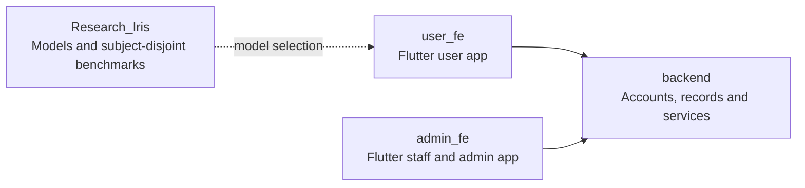
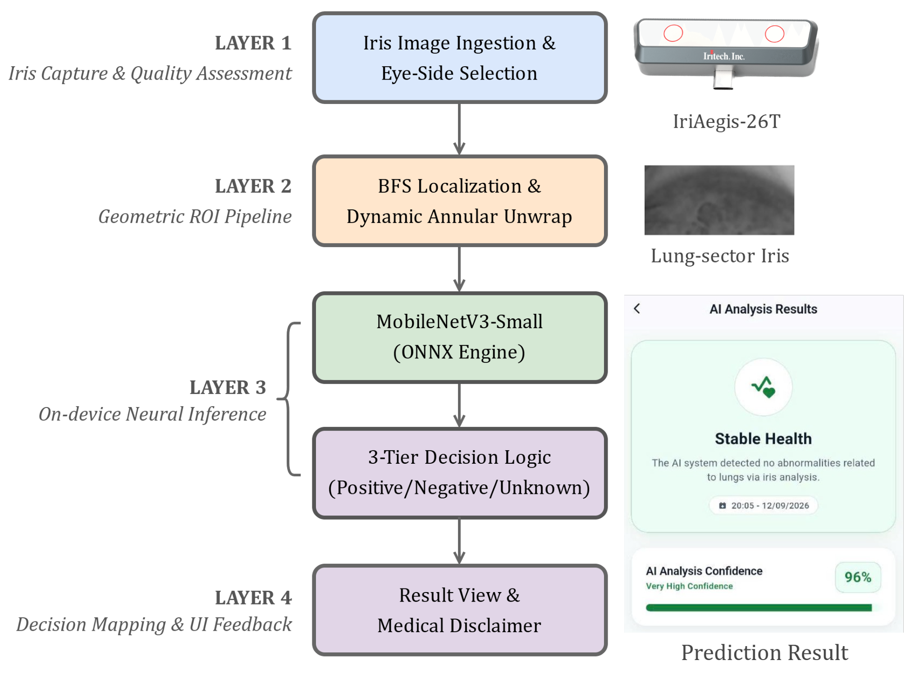
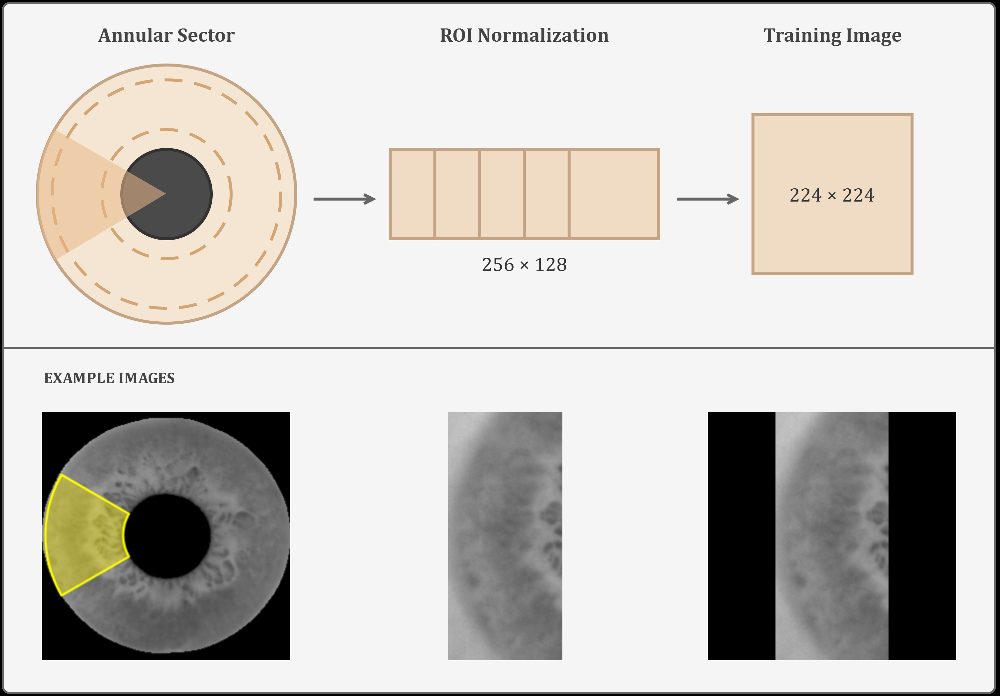
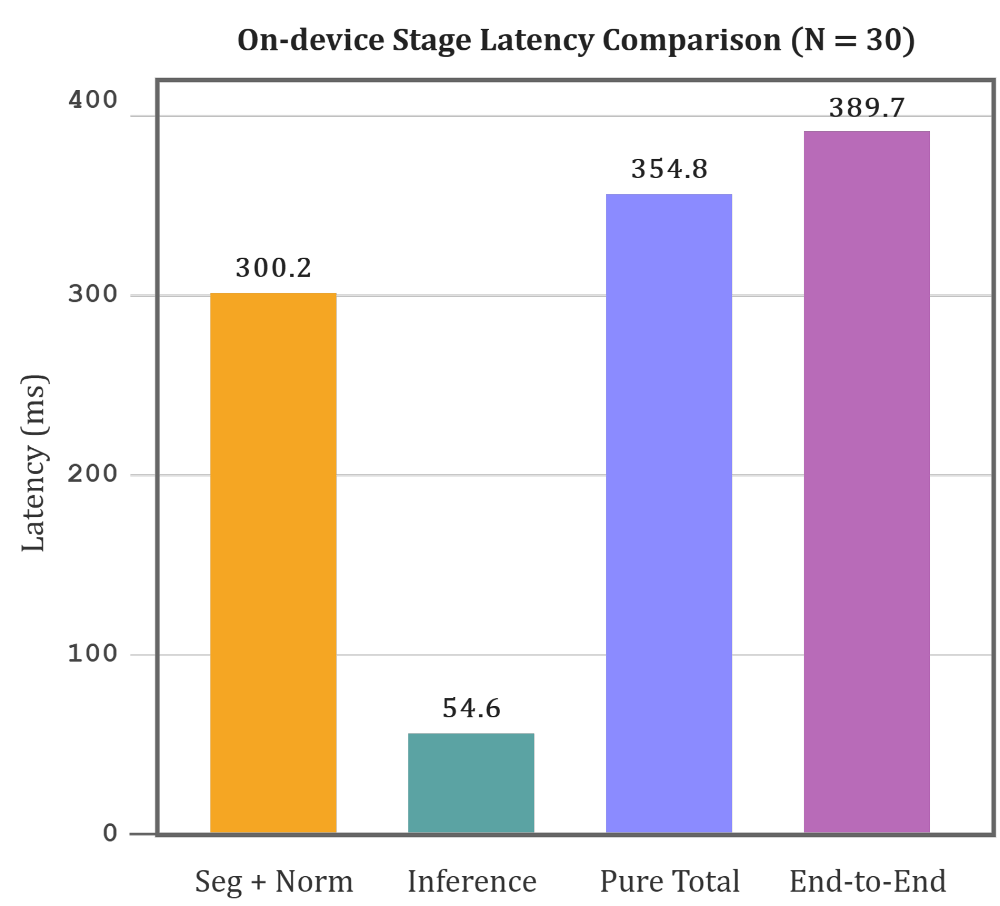

<h1 align="center">IrisHealth</h1>

  <strong>Iris image analysis · Subject-disjoint evaluation · On-device AI</strong>

  
  
  
  

  <a href="#overview">Overview</a> ·
  <a href="#system-architecture">Architecture</a> ·
  <a href="#key-results">Results</a> ·
  <a href="#project-repositories">Repositories</a> ·
  <a href="#conference-contribution">Conference</a>

---

## Overview

IrisHealth is an engineering research prototype that investigates whether images of predefined iris sectors can be classified according to the labels in a lung-sector iris dataset and processed interactively on a mobile device. The work joins a controlled deep learning benchmark with a Flutter application, an on-device image-processing pipeline, and supporting services for user and staff workflows. It evaluates agreement with dataset labels; it does **not** establish iris sectors as clinically valid indicators of pulmonary disease.

In the paper's mobile inference path, an iris image is captured and processed locally: the app locates the pupil and iris, extracts a dynamic annular sector, unwraps it into a rectangular region of interest (ROI), and pads and normalizes it for a `1 × 224 × 224` model input. A MobileNetV3-Small model runs through ONNX Runtime on the device. The app maps its binary score to **Positive**, **Negative**, or an **Unknown** band for ambiguous results, with an explicit research-use disclaimer. The paper describes optional synchronization of screening summaries while raw frames and ROI tensors remain on the device in this path.

The research benchmark compares seven model architectures using subject-disjoint train, validation, and test partitions so images from one person cannot cross partitions. Source images labeled Unknown are excluded from binary training. ConvNeXt-Tiny is the offline accuracy reference, while the smaller MobileNetV3-Small is selected for mobile deployment.

## System architecture

The repositories separate experimental model development from the user and staff applications. Both applications use the backend for their account and record workflows; the paper's measured classification path runs locally in the mobile client.

The paper's layered on-device architecture moves from capture and eye-side selection through geometric ROI processing, MobileNetV3-Small inference, three-tier decision mapping, and result display. Optional history synchronization is outside the local classification path.

*On-device architecture reproduced from Figure 3 of the conference manuscript. The app screen is illustrative; its label is not a medical diagnosis.*

### Iris region-of-interest pipeline

The pupil and iris boundaries define an annular sector. The sector is unwrapped to `256 × 128`, then padded without stretching into a `224 × 224` input image shared by offline training and mobile inference.

*ROI extraction and normalization reproduced from Figure 1 of the conference manuscript. Sector angles are dataset protocol assumptions, not clinically validated anatomical maps.*

## Key results

| Evaluation | Paper-reported result |
| :--- | ---: |
| Binary benchmark cohort | **10,892 images · 6,606 subjects** |
| ConvNeXt-Tiny · offline reference | **96.21% accuracy · 94.18% F1** |
| MobileNetV3-Small · mobile model | **94.14% accuracy · 91.10% F1** |
| End-to-end mobile latency | **389.7 ± 16.5 ms** on one Galaxy Tab A9, 30 runs |

<em>Dataset and device-specific engineering results; no clinical validation is claimed.</em>

### Seven-model comparison

The paper reports the following held-out test results under a shared training protocol and subject-disjoint split. Values are mean ± standard deviation across three seeds; **F1** is the primary comparison metric.

| Model | Accuracy | F1 |
| :--- | ---: | ---: |
| **ConvNeXt-Tiny** · offline reference | **0.962 ± 0.002** | **0.942 ± 0.003** |
| Swin-T | 0.957 ± 0.007 | 0.934 ± 0.011 |
| VGG-16 | 0.955 ± 0.002 | 0.931 ± 0.003 |
| ResNet-18 | 0.953 ± 0.003 | 0.927 ± 0.005 |
| EfficientNet-B0 | 0.949 ± 0.004 | 0.922 ± 0.005 |
| DenseNet-121 | 0.947 ± 0.005 | 0.919 ± 0.008 |
| **MobileNetV3-Small** · mobile model | **0.941 ± 0.003** | **0.911 ± 0.005** |

*The manuscript's prose gives selected percentages to two decimals; its comparison table rounds means to three decimals.*

### Mobile latency

On the Galaxy Tab A9, geometric preprocessing and ROI extraction account for **300.2 ms** of the **354.8 ms** pure compute time (about **84.6%**); model inference accounts for **54.6 ms**. End-to-end latency, including I/O, is **389.7 ± 16.5 ms** across 30 runs.

*Latency breakdown reproduced from Figure 4 of the conference manuscript; measured on one device.*

## Project repositories

| Repository | Purpose |
| --- | --- |
| [`backend`](https://github.com/IrisAppProject/backend) | FastAPI services and REST APIs for accounts, iris scans, screening records, consultations, and administration. |
| [`user_fe`](https://github.com/IrisAppProject/user_fe) | Flutter mobile app for iris capture, screening, and access to personal records. |
| [`admin_fe`](https://github.com/IrisAppProject/admin_fe) | Flutter app for clinical staff and administrators to manage intake, scans, records, and role-based access. |
| [`Research_Iris`](https://github.com/IrisAppProject/Research_Iris) | Model training, benchmarks, and exploratory iris-image classification experiments; the conference paper's benchmark uses a binary Positive/Negative protocol. |

Each repository contains its own setup instructions and technical documentation. Research datasets and training artifacts are not included in `Research_Iris`.

## Conference contribution

**“Design and Mobile Deployment of a Deep Learning-Based Lung-Sector Iris Screening System”** is listed as a **Final Paper** submission (No. 189) for the **2026 ASIAN Conference on Communication and Networks**. The conference notice records an **online presentation** (No. 25) and states that the paper is planned for inclusion in the proceedings. The final decision is subject to release of the conference program by the organizing committee.

## Research boundaries

The paper evaluates one dataset source and profiles latency on one mobile device. Independent external validation and prospective clinical evaluation remain necessary before any diagnostic use. **Positive**, **Negative**, and **Unknown** in the app are research output labels, not confirmed medical findings.
